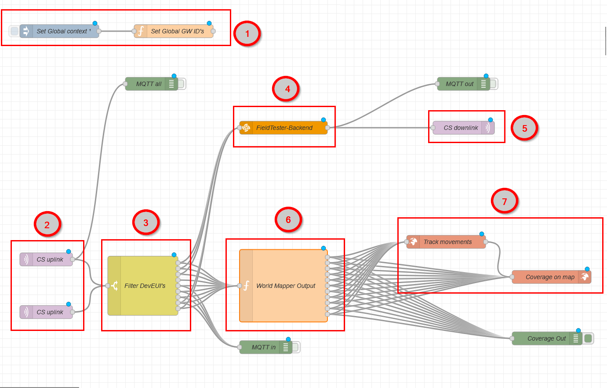
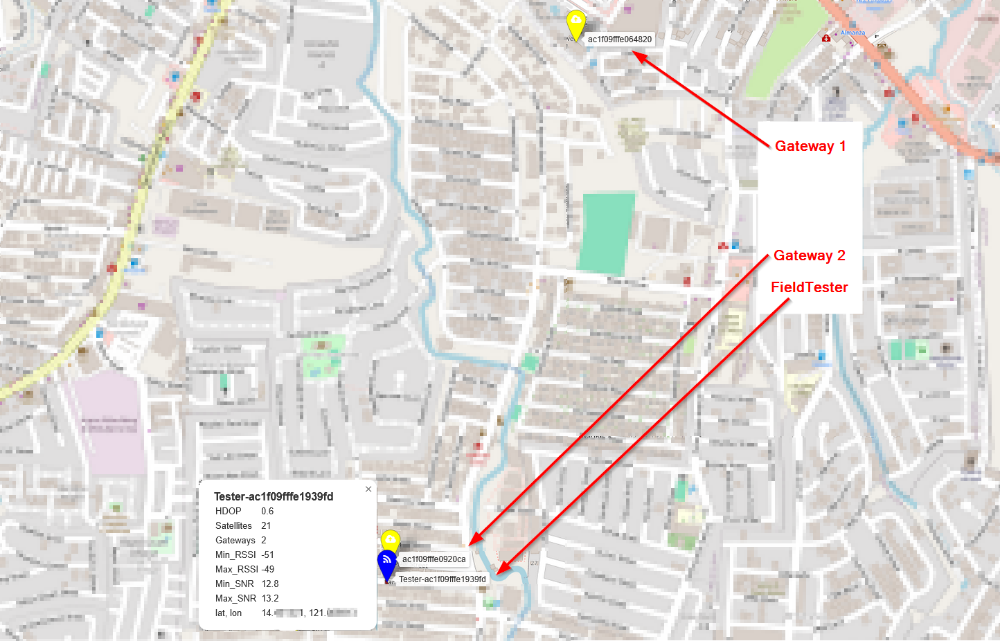
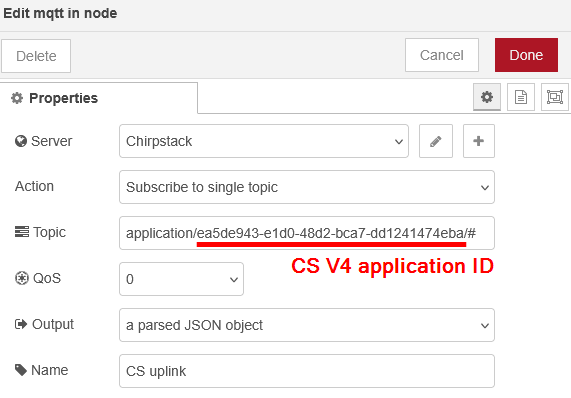
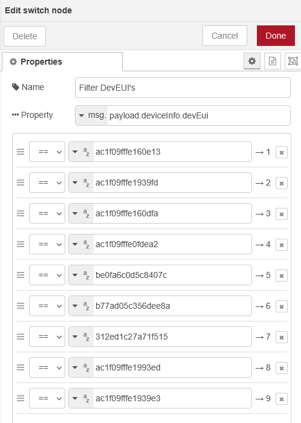
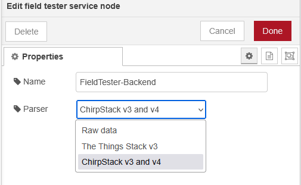
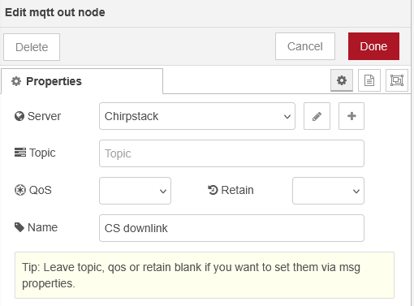
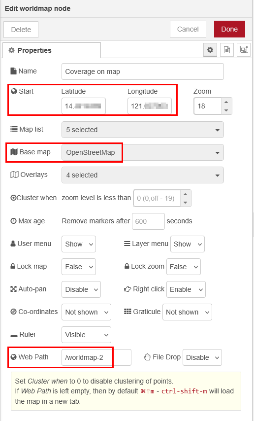

# Node-RED backend for Field Tester 

This tutorial shows how to setup a backend for the RAK10701-L Field Tester from RAKwireless with Node-RED.
It requires some additional external nodes to work.
It is tested with Chirpstack V4 as LoRaWAN server, for other LNS changes are required.

This Node-RED flow connects to the MQTT broker of the LNS (CS V4), filters out the packets of defined devices (the Field Testers) and feeds the filtered results into the _**field tester service**_ flow which generates the required downlinks to the Field Tester with the required information.

In addition it analysis the received packets and places the found gateways and Field Tester locations on a map, together with track movement using the _**node-red-contrib-web-worldmap**_ flow. This step is optional and not required for the Node-RED flow to work as a backend for the Field Tester.

## Overview
An overview of the Node-RED flow for the Field Tester backend flow:

<center></center>

1. _**Set Global GW ID's**_ is setting up a list of known gateways that are used in the test.
2. _**CS Uplink**_ is the MQTT connection to the gateway. Here two connections are setup for two different applications in the Chirpstack V4 server.
3. _**Filter DevEUI's**_ is a filter, that let's only Field Tester packets through for processing
4. _**Field Tester-Backend**_ is a node that creates the required downlink packets for the Field Tester
5. _**CS downlink**_ is the MQTT connection to the gateway to initiate the downlink packets to the Field Tester
6. _**World Mapper Output**_ is parsing the received data from the LoRaWAN server to extract locations for the gateways and the Field Testers. It creates the message required for the mapper nodes. It supports up to 10 Gateways per Field Tester test message.
7. _**Track movements**_ and _**Coverage on map**_ are the nodes that create the map with the gateway and Field Tester 

The resulting map with two gateways and one Field Tester:

<center></center>

## Backend Details

### List with Gateway ID's
This list is not absolutely required if the backend is used without the visualization map.     
But in the information received through the MQTT broker subscription, the gateways are not always in the same sequence, which makes it more difficult to show them on the visualization map. The list assigns a color to each gateway, which is then used in the map.

### MQTT incoming connection (2)
This MQTT connection is the subscription to the LoRaWAN server's MQTT broker.     
The setup in the example flow is setup for Chirpstack V4. For other LoRaWAN servers the subscription topic needs to be adjusted to the output of the LoRaWAN server.    

For Chirpstack, the subscription topic includes the application ID which has to be defined matching the specific setup used.

<center></center>

### Filter (3)
The filter contains a list with DevEUI's of the FieldTesters used. It can be simplified if only a single FieldTester is used.     
The filter stops data coming from other nodes to go into the backend process and the visualization map.    

<center></center>

### FieldTester-Backend (4)
This node is provided by RAKwireless and does parse the received data and create the downlink packet to the FieldTester with the distance, RSSI and other information.     
The node can be configured to handle inputs and outputs from TheThingsStack, Chirpstack V3 and V4. It can handle as well raw data.      
#### ⚠️ This node is designed to work with FieldTester RAK10701-L and RAK10701-P. It is not compatible with the new FieldTester-Plus protocol.

<center></center>

#### ⚠️ I did not test the node with Raw Data. For further information, check the documentation of this node in the [field-tester-service](https://github.com/RAKWireless/field-tester-server/tree/main/node-red-node) repository.

### MQTT outgoing connection (5)
This MQTT connection triggers the downlink packet for the Field Tester by publishing a downlink request to the LoRaWAN server.    
The FieldTester-Backend node (4) already formats the published message in the correct format for TheThingsStack, Chirpstack V3 and V4. Beside of the connection to the MQTT broker no other setup is required.

<center></center>

#### ⚠️ If no visualization of the Field Tester and the Gateways is required, the Node-RED based backend for the Field Tester is now ready to work.

### World Mapper Output (6)
This node is parsing the incoming packet from the Field Tester and extracts the location of the Field Tester and the gateway locations from the packet and from the information provided by the LoRaWAN server.    

#### ⚠️ This nodes function is written specifically for a Chirpstack V4 LoRaWAN server. If other servers are used, the parsing of the data has to be adjusted.    

**The Chirpstack V4 specific parsing is prepared in the function `parser_cs34(msg)`. The names of the relevant data (data, gateway count and gateway RX info) will be different for Chirpstack V3, TTN and other servers.**

```js
function parser_cs34(msg) {

    // avoid sending downlink ACK to integration
    var port = msg.payload.fPort;
    if ((port != 1) && (port != 11)) {
        // node.warn("Wrong fPort " + port);
        return null;
    }
    // get raw input
    var bytes = Buffer.from(msg.payload.data, 'base64');
    var sequence_id = msg.payload.fCnt;
    var gateways = msg.payload.rxInfo;

    // get response
    var new_messages;
    if ((bytes[6] == 86) && (bytes[7] == 50)) {
        new_messages = ftdProcess_V2(bytes, port, sequence_id, gateways);
        // node.warn("Got V2 message from " + msg.payload.deviceInfo.devEui);
    } else {
        new_messages = ftdProcess(bytes, port, sequence_id, gateways);
        // node.warn("Got V1 message from " + msg.payload.deviceInfo.devEui);
    }
    if (!new_messages) {
        node.warn("ftdProcess returned no data");
        return null;
    }

    return new_messages;

}
```

After parsing the input, the node is creating output for each found gateway and the Field Tester itself in the correct format for the _**node-red-contrib-web-worldmap**_ node.    
This output is then sent to the tracker node and the map creation node.     
The information sent out includes colors and different icons for the gateways and the Field Tester.    

### Track movements and Coverage on map (7)
These are ready available nodes from the _**node-red-contrib-web-worldmap**_ flow.    
#### Track movements
This node will draw tracking lines that shows the movement of the Field Tester on the map.     
No specific setup was done for this node.
#### Coverage on map
This node will draw the location of the devices on the map.    
No specific setup was done for this node beside:
- Set start location (optional)
- Choose OpenStreetMap as map provider
- Set a URL name for the map.

<center></center>

## Complete flow for the FieldTester Backend flow:

[node-red-flow.json](./assets/node-red-flow.json)    
